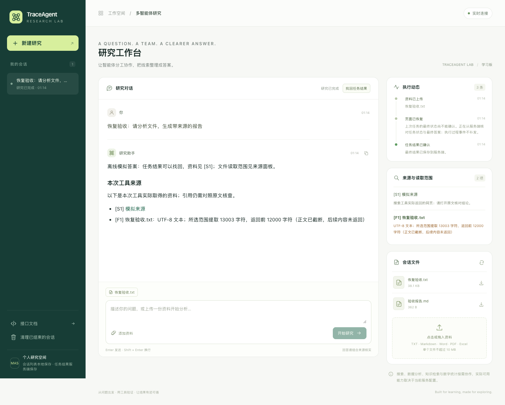
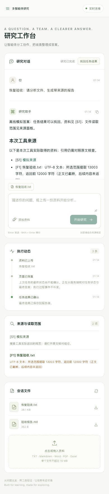
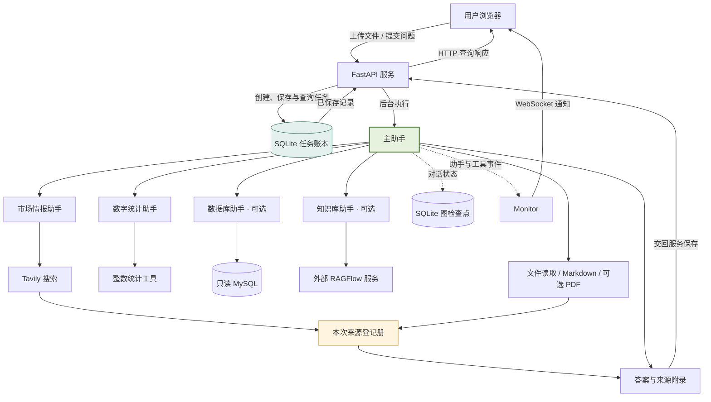
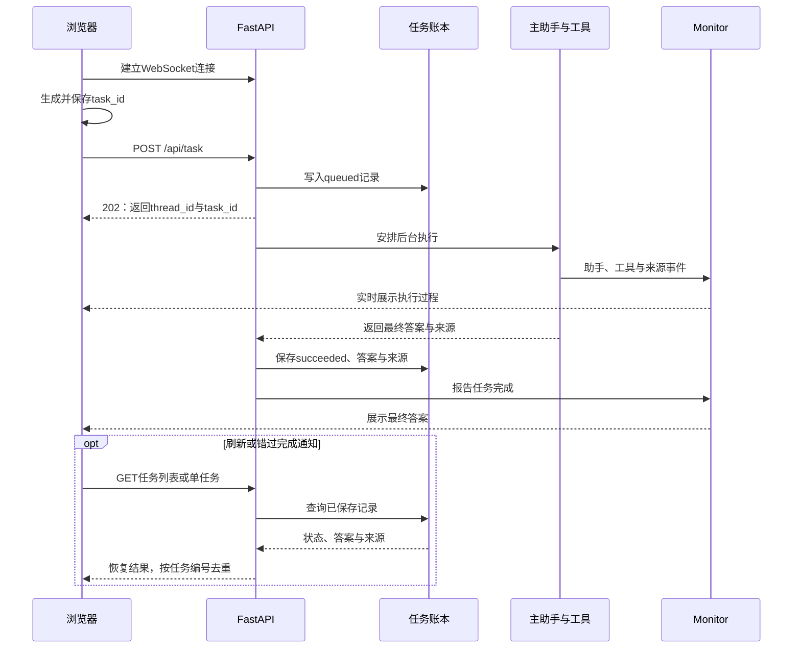

<h1 align="center">🔎 TraceAgent Lab</h1>

<p align="center"><strong>可追溯的多智能体研究工作台 · 从零开始的 AI Agent 实战教程</strong></p>

<p align="center">
  
  
  
  
  
  <a href="LICENSE"></a>
</p>

<p align="center">让答案有出处，让读取有边界，让任务结果可以找回。</p>

[项目预览](#preview) · [系统架构](#architecture) · [快速开始](#quickstart) · [从零复刻](#tutorials) · [源码阅读](#reading) · [常见问题](#faq)

---

## 🎯 项目介绍

TraceAgent Lab 是一个面向 Python 与 AI Agent 学习者的多智能体研究项目。你在网页提出问题，主助手按需求委派搜索、数字统计或已启用的数据库、知识库助手；工具取得资料后，主助手整理答案，并按需生成 Markdown 或 PDF 报告。

项目基于 [jayergood/MultiAgent-Search](https://github.com/jayergood/MultiAgent-Search) 学习复刻与扩展，提供成品应用和 **第 00～40 步，共 41 篇复刻教程**。你可以先运行工作台，也可以在空目录逐步搭建，理解每个文件、函数、变量及其调用关系。

适合希望完成以下目标的学习者：

- 已学过一些 Python，希望把模型调用、工具和 Web 服务连成完整应用。
- 想看清主助手怎样委派任务、子助手怎样执行工具、结果怎样返回。
- 想通过具体例子理解 `async/await`、ContextVar、WebSocket 和 SQLite。
- 希望在复刻之后完成自己的改造，并能解释设计与验收方式。

<a id="features"></a>

## ✨ 核心功能与三项改造

### 一个可交互的研究工作台

| 能力 | 你可以怎样使用 |
| --- | --- |
| 多智能体分工 | 主助手协调公开搜索、数字统计，以及可选的数据库与知识库助手 |
| 文件分析 | 上传 TXT、Markdown、DOCX、文字 PDF 或 XLSX，让助手读取并整理 |
| 报告生成 | 按需生成 Markdown，再通过可用的 PDF 工具转换 |
| 执行过程展示 | 在网页查看助手委派、工具调用、结果与错误动态 |
| 会话与状态保存 | 会话目录隔离文件，SQLite 检查点保存图状态 |
| 文件管理 | 在当前会话中查看文件并下载报告或上传资料 |

### ① 来源可核查

搜索工具为实际取得的网页登记 `S1`、`S2` 等来源编号，保留标题和 URL；文件读取使用 `F1`、`F2`。答案与 Markdown 报告附上本次工具来源，网页提供可点击链接和文件范围说明。

**来源目录说明工具取得过哪些资料，具体结论仍需对照原文。** 当前没有自动逐句事实核验。

### ② 读取范围透明

文件工具同时返回正文和读取说明，不把部分预览说成完整分析：

| 格式 | 当前读取范围 |
| --- | --- |
| TXT / Markdown | UTF-8 文本，返回正文最多 12,000 字符 |
| DOCX | 正文段落；不读取表格、图片、页眉页脚 |
| PDF | 前 20 页文字层；不执行 OCR |
| XLSX | 首个工作表，最多取 100 行数据，正文预览前 10 行；不推断全表总行数 |

上述格式的正文都受 **12,000 字符** 上限约束。超过上限会明确标注截断；Excel 预览还会说明单元格展示上限。

### ③ 任务结果可找回

区分整段会话的 `thread_id` 和一次提问的 `task_id`。任务先入账，执行结束后先保存答案与来源，再发送完成通知。刷新或漏掉 WebSocket 通知时，页面主动查询服务端，恢复已保存的最终结果。

同一个任务编号重复提交相同请求会复用记录，页面按任务编号更新答案，避免反复显示。同一会话已有活跃任务时，后端返回 `409`。

**结果找回恢复状态与最终答案，不回放全部执行事件，也不自动续跑中断任务。** 来源编号只在单次任务内有效，旧版没有入账的历史任务不会自动迁移。

<a id="preview"></a>

## 🖥️ 项目预览



> 演示图使用模拟资料，展示结果找回和来源面板，不包含真实用户上传内容。

<details>
<summary>查看移动端预览</summary>



</details>

<a id="architecture"></a>

## 🏗️ 系统架构

### 整体架构



默认注册搜索和数字统计两类业务助手；MySQL、RAGFlow 按配置与连接探测结果注册。PDF 工具也会检查依赖，不可用时不加入工具名单。

### 一次任务怎样运行



图检查点保存“这段对话的执行状态”，任务账本保存“这次提问的受理与最终结果”。两者使用独立数据库文件，ContextVar 则负责当前执行路线中的目录、编号和来源上下文。

<a id="quickstart"></a>

## 🚀 快速开始

### 环境要求

- **Python 3.11**，建议使用独立虚拟环境。
- **uv**，用于创建环境与安装锁定依赖；标准 venv 备用方式见[第 00 步](01_第00步_目录与运行环境.md)。
- 自己可用的模型服务与 Tavily 凭据；当前模型配置以 **DeepSeek** 为基线。

MySQL 与 RAGFlow 是可选分支。前端由 FastAPI 直接提供，日常运行不需要另外安装 Node 或启动前端构建服务。

以下命令使用 macOS / Linux，在**本仓库根目录**执行，也就是包含 `requirements.lock.txt` 的目录。

### 1. 创建环境并安装依赖

可在仓库页面选择 **Code → Download ZIP** 下载并解压，也可以克隆：

```bash
git clone https://github.com/zhou56031-ai/MultiTraceAgent.git
cd MultiTraceAgent
```

进入项目根目录后执行：

```bash
uv venv --python 3.11 .venv
uv pip install --python .venv/bin/python -r requirements.lock.txt
```

macOS 已有 Homebrew 但没有 uv 时，可先执行 `brew install uv`。`requirements.txt` 记录直接依赖，`requirements.lock.txt` 保存完整解析版本。

### 2. 创建本地配置

新副本没有 `.env` 时执行：

```bash
cp .env.example .env
```

随后用编辑器填写这四项：

```dotenv
OPENAI_BASE_URL=https://api.deepseek.com/v1
OPENAI_API_KEY=replace_with_your_model_api_key
LLM_QWEN_MAX=replace_with_a_model_available_to_your_account
TAVILY_API_KEY=replace_with_your_tavily_api_key
```

其中 `LLM_QWEN_MAX` 是沿用的历史键名，值应填写你账户实际可用的模型 ID。替换以上占位值后再运行；已有真实配置时不要用模板覆盖。

`.env.example` 还包含可选 MySQL、RAGFlow 配置。`DASHSCOPE_API_KEY` 为后续百炼 Embedding 扩展预留，当前三项改造不调用 Embedding。

### 3. 启动应用

```bash
.venv/bin/python -m uvicorn api.server:app --host 127.0.0.1 --port 8001
```

- **工作台：** http://127.0.0.1:8001/
- **接口文档：** http://127.0.0.1:8001/docs

当前使用单进程执行模式；多 worker 的连接共享和任务执行租约尚未实现。

### 4. 试一次任务

可以直接在工作台输入：

> 请委派数字统计助手，使用工具计算 10,20,30 的数量、合计与平均值。

也可以通过接口提交，服务会自动生成编号：

```bash
curl -X POST http://127.0.0.1:8001/api/task \
  -H 'Content-Type: application/json' \
  -d '{"query":"请委派数字统计助手，使用工具计算10,20,30的数量、合计与平均值。"}'
```

响应中的 `task_id` 可用于查询这次任务；`started` 或 HTTP `202` 只表示受理，最终结果以完成事件或任务查询为准。外部模型和搜索调用使用你自己的账户用量。

### 5. 验收三项改造

| 操作 | 应观察到什么 |
| --- | --- |
| 提问并要求联网搜索、标注出处 | 来源面板出现网页编号和可打开的链接，答案保留对应引用 |
| 上传超过 12,000 字符的 TXT，要求说明读取范围 | 出现文件编号、实际返回字符数与截断提示 |
| 任务提交后在完成前刷新页面，再点击“找回任务结果” | 页面查询账本恢复结果，不自动重新提交，重复核对不重复显示答案 |

### 可选：PDF 与 Docker

macOS 生成 PDF 需要渲染库和可用中文字体：

```bash
brew install pango libffi
.venv/bin/python -c 'import markdown; from weasyprint import HTML; print("PDF依赖可用")'
```

安装与排错见[第 19 步](14_第19步_Mac版Markdown转PDF.md)和[WeasyPrint 官方说明](https://doc.courtbouillon.org/weasyprint/stable/first_steps.html)。

使用 Docker 时，在根目录执行：

```bash
mkdir -p data updated output
docker compose -f docker-compose.learning.yml up --build -d
```

Compose 当前只包含应用，数据库和知识库服务需另配。8001 被占用时可在启动前设置 `export LEARNING_HOST_PORT=8002`。详见[第 25 步](20_第25步_容器运行与本地配置.md)。

<a id="tutorials"></a>

## 📚 从零复刻：00～40 步

**先运行成品，再在新的空目录自己搭一遍。** 教程中的 `learning/` 是你的练习项目根目录；不要用早期阶段代码覆盖正在使用的成品。

入口：[完整步骤导航与学习方法](00_复刻全过程概要.md) · [项目设计与技术路线](项目全景_设计思路架构与技术路线.md)

| 阶段 | 步骤 | 你将逐步完成 |
| --- | --- | --- |
| 接通最小链路 | [00～06](01_第00步_目录与运行环境.md) | 解释器、模型、普通函数与工具、Tavily、YAML、搜索助手、主图委派 |
| 建立 Web 应用 | [07～14](02_第07步_会话目录与ContextVar.md) | 会话目录、ContextVar、文件、SQLite、HTTP、WebSocket、上传下载与页面 |
| 增加业务与稳定性 | [15～26](10_第15步_MySQL数据库助手.md) | 可选 MySQL/RAGFlow、重试、多格式、PDF、异常与取消、完整上传、容器 |
| 专项验收与独立扩展 | [27～34](22_第27步_真实搜索委派链路.md) | 搜索/并发/数据库/知识库/报告等验收，以及增加数字统计助手 |
| 做出三项改造 | [35～39](30_第35步_文件读取范围与来源登记册.md) | 来源登记、读取范围、任务账本、查询接口、前端恢复 |
| 联合验证 | [40](35_第40步_可信来源与任务恢复联合验收.md) | 屏蔽通知后查回结果，验证幂等、来源、边界与答案去重 |

每步围绕文件职责、函数参数、关键变量、具体执行例子与验收方法展开。替换代码时提供位置和旧版/新版对照；验证脚本统一放在 `examples/`。

## 📖 你能学到什么

| 知识点 | 对应实现与学习问题 |
| --- | --- |
| 主子助手分工 | `agent/main_agent.py`：主模型怎样选择助手，结果怎样返回 |
| 工具描述与执行 | `tools/`：`@tool` 怎样提供参数结构，谁真正执行函数 |
| 提示词配置 | `prompt/prompts.yml`：岗位介绍、执行规则与注册名单怎样配合 |
| 异步任务生命周期 | `api/server.py`：请求受理后怎样安排后台执行与清理 |
| 实时通信 | `api/monitor.py`：事件怎样交回正确的循环并发送给会话 |
| 执行上下文 | `api/context.py`：深层工具如何取得当前目录和编号 |
| 来源上下文 | `api/evidence.py`：子助手与工具怎样共用登记册、去重与编号 |
| 任务持久化 | `api/task_store.py`：幂等创建、活跃任务约束与终态保存 |
| 文件路径与解析边界 | `utils/path_utils.py`、读取工具：如何限定目录并说明实际读取范围 |
| 外部业务服务 | SQL/RAGFlow 工具：连接可用、工具可用与真实委派成功为何要分开验证 |

## 📁 项目结构

```text
traceagent-lab/
├── agent/
│   ├── llm.py                       # 模型配置
│   ├── prompts.py                   # YAML加载
│   ├── main_agent.py                # 主图、会话准备与生命周期
│   └── subagents/                   # 搜索、数字、可选数据库/知识库助手
├── api/
│   ├── server.py                    # HTTP与WebSocket入口
│   ├── context.py                   # 会话上下文
│   ├── evidence.py                  # 本次来源登记册
│   ├── task_store.py                # SQLite任务账本
│   ├── monitor.py                   # 事件与连接管理
│   └── static/index.html            # 研究工作台
├── tools/                          # 搜索、数字、文件、SQL、知识库和报告工具
├── utils/                          # 路径、重试与PDF转换
├── prompt/prompts.yml              # 助手规则
├── examples/                       # 分步练习与正式代码验收
├── sql/                            # 只读练习库初始化材料
├── docs/assets/                    # 演示图片
├── 00_复刻全过程概要.md
├── ...第00～40步教程.md
├── .env.example                    # 公开配置模板
├── .gitignore
├── requirements.txt                # 直接依赖
├── requirements.lock.txt           # 完整依赖版本
├── Dockerfile
├── docker-compose.learning.yml
├── CONTRIBUTING.md
├── LICENSE
└── README.md
```

首次运行后会按需创建 `data/`、`updated/` 和 `output/`，分别保存本地数据库、上传资料和会话文件；这些运行数据不随源码发布。

<a id="reading"></a>

## 🧭 推荐源码阅读顺序

| 顺序 | 文件 | 带着什么问题读 |
| --- | --- | --- |
| 1 | [agent/llm.py](agent/llm.py) | 模型对象从哪些配置创建，什么时候才真正发请求 |
| 2 | [提示词](prompt/prompts.yml) / [加载器](agent/prompts.py) | YAML中的规则怎样变成Python数据 |
| 3 | [tools/number_tools.py](tools/number_tools.py) | 从一个确定的计算工具理解输入、返回与错误 |
| 4 | [搜索助手配置](agent/subagents/network_search_agent.py) | name、description、system_prompt、tools分别负责什么 |
| 5 | [agent/main_agent.py](agent/main_agent.py) | 构图、执行、委派、最终结果与清理怎样连接 |
| 6 | [api/server.py](api/server.py) | HTTP请求怎样变成后台任务，何时写入账本 |
| 7 | [会话上下文](api/context.py) / [实时事件](api/monitor.py) | 谁在替哪个会话工作，通知怎样到达页面 |
| 8 | [来源登记](api/evidence.py) / [任务账本](api/task_store.py) | 本次执行上下文与持久结果为什么分开保存 |
| 9 | [api/static/index.html](api/static/index.html) | 页面如何接收通知、恢复任务并防止重复答案 |
| 10 | [联合验收脚本](examples/40_reliability_check.py) | 如何证明一条链路真的完成，而不只是成功导入 |

## 🧪 验证与练手

### 运行离线验证

在项目根目录执行：

```bash
.venv/bin/python examples/00_06_tutorial_check.py
.venv/bin/python examples/35_read_scope.py
.venv/bin/python examples/36_evidence.py
.venv/bin/python examples/37_task_store.py
.venv/bin/python examples/40_reliability_check.py
```

这些实验使用真实文件、SQLite、正式工具与 HTTP 处理逻辑，模型和搜索响应明确模拟；来源实验还实际执行 DeepAgents 父子图。它们不使用真实付费 API，也不代替真实模型、MySQL、RAGFlow 和 PDF 排版的专项验收。

### 再做几项自己的练习

- [ ] 改变搜索结果数量，观察返回资料与来源条目的变化。
- [ ] 调整岗位提示词，比较工具调用过程，保留可复现的测试输入。
- [ ] 跟随第 33 步增加业务助手，再给它补直接工具与委派验证。
- [ ] 为文件读取增加分段参数，同时返回准确的新读取范围。
- [ ] 为任务增加主动取消接口，明确取消后文件、账本和图状态怎样处理。
- [ ] 设计事件持久化与回放，进一步解决断线期间的过程通知缺失。

以上待办是练习方向，不代表当前版本已经实现。

## 🔧 技术栈

| 层次 | 技术 | 在项目中的作用 |
| --- | --- | --- |
| 模型接入 | LangChain / langchain-openai | 通过兼容适配器连接当前配置的模型 |
| 助手执行 | DeepAgents / LangGraph | 组织模型、工具、子助手与图状态 |
| Web服务 | FastAPI / Uvicorn | HTTP接口、异步任务与WebSocket连接 |
| 状态与结果 | SQLite / AsyncSqliteSaver | 图检查点与独立任务账本 |
| 公开搜索 | Tavily | 返回网页资料与来源URL |
| 数据与知识库 | MySQL / RAGFlow，可选 | 只读业务查询与已有知识库问答 |
| 文件读取 | python-docx / pypdf / pandas / openpyxl | 分格式提取正文与预览 |
| 报告转换 | Markdown / WeasyPrint | Markdown生成与可选PDF转换 |
| 前端 | HTML / CSS / JavaScript | 无单独构建服务的研究工作台 |

<a id="faq"></a>

## ❓ 常见问题

### 没有 MySQL 或 RAGFlow，也能开始吗？

可以。先配置模型与 Tavily，体验搜索、数字统计和文件任务。数据库与知识库助手按实际配置和服务探测结果启用；上传文件不会自动进入 RAGFlow 数据集。

### 为什么同时需要检查点、ContextVar 和任务账本？

ContextVar 让当前调用链知道目录、编号和来源；检查点保存会话执行图状态；任务账本提供一次提问的状态与最终结果查询。它们解决不同问题，不能互相替代。

### 刷新恢复，是不是任务会重新执行？

页面恢复时查询服务端记录，不自动重新提交问题。成功任务恢复已保存答案；上次进程遗留的运行态会标记为中断，不假装已经自动续跑。

### 可以换成其他模型吗？

可以作为扩展练习。当前 `agent/llm.py` 采用兼容适配器，并带有 DeepSeek 请求参数；更换服务时应同时核对模型 ID、API 地址、工具调用支持和额外参数，而不只替换 Key。

### 为什么 PDF 或 Excel 没有全部分析？

当前工具按明确的页数、预览行数和字符预算返回材料，范围会显示给模型和页面。扫描 PDF 需要额外 OCR，复杂表格或整表统计需要专门工具，不能把预览结果当作全文件分析。

### 可以直接当成共享的多用户服务部署吗？

当前侧重本地学习和二次开发，尚无登录、跨设备会话目录、多进程执行租约或历史文件版本管理。用户主动取消与完整事件回放也仍是扩展方向。当前边界和三项改造的范围已在本文对应章节说明；设计细节见[架构全景](项目全景_设计思路架构与技术路线.md)。

## 🤝 参与改进

欢迎补充可复现的问题、具体例子、文档排错与独立业务助手。正式代码与教程应同步更新，真实服务和模拟实验分别标明。详见[贡献说明](CONTRIBUTING.md)。

真实 Key 只保存在本地 `.env`，公开仓库提供 `.env.example`。贡献前可以运行 `examples/publish_check.py`，暂存后加 `--staged` 检查实际提交内容；个人上传资料、数据库与生成文件不提交。

## 📄 许可证与致谢

本项目的复刻起点是 **[jayergood/MultiAgent-Search](https://github.com/jayergood/MultiAgent-Search)**。感谢原项目提供的主子助手、工具和 Web 服务学习范例。

TraceAgent Lab 在此基础上整理分步教学与工作台，进一步实践来源登记、文件读取边界和任务结果恢复。保留原作者版权声明，使用 [MIT License](LICENSE)。
