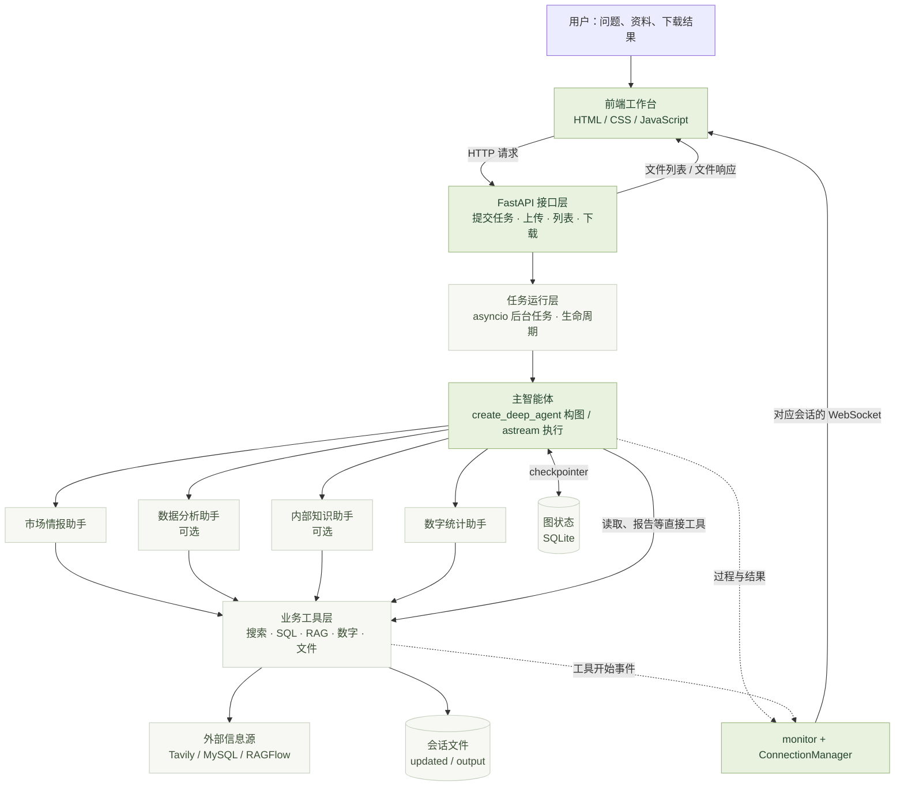
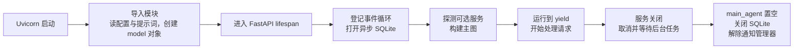
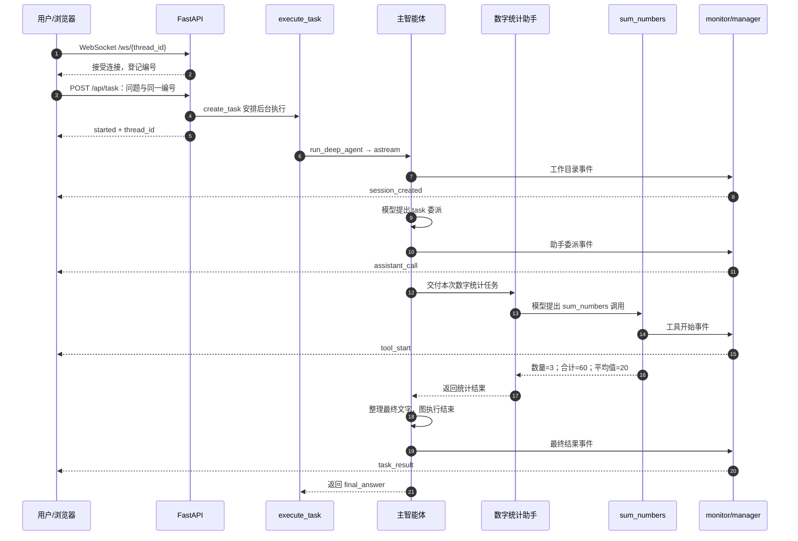
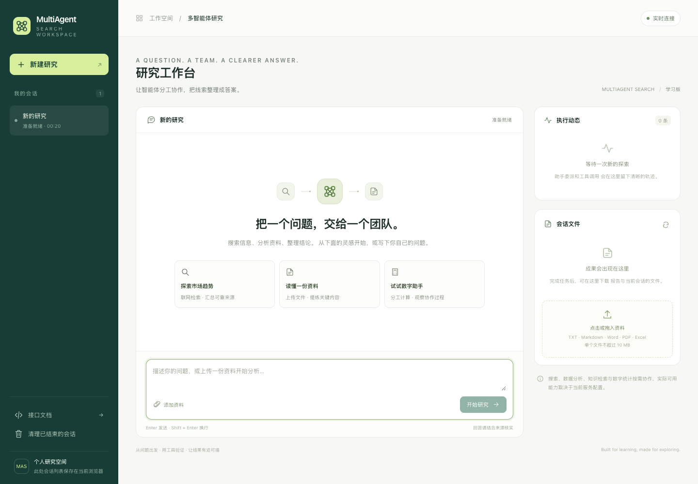
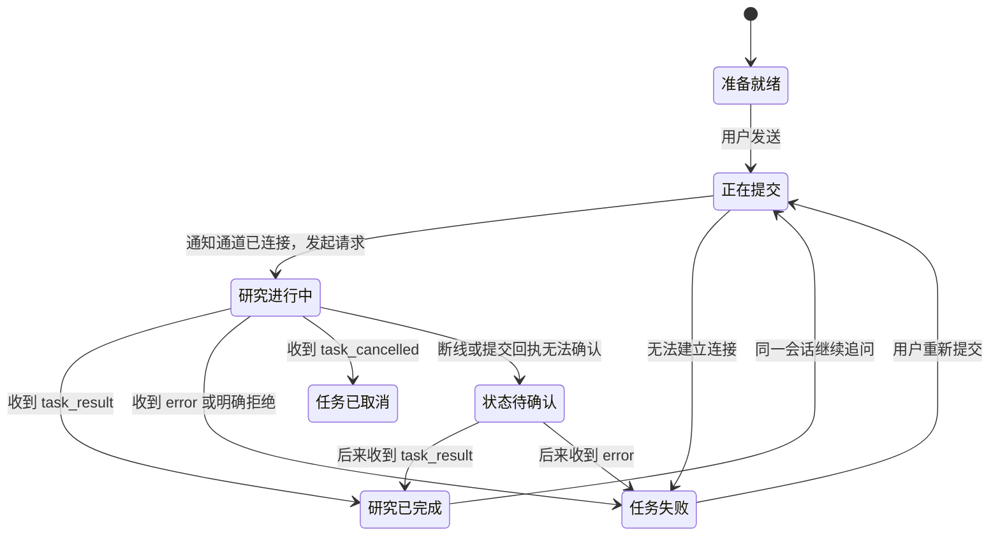
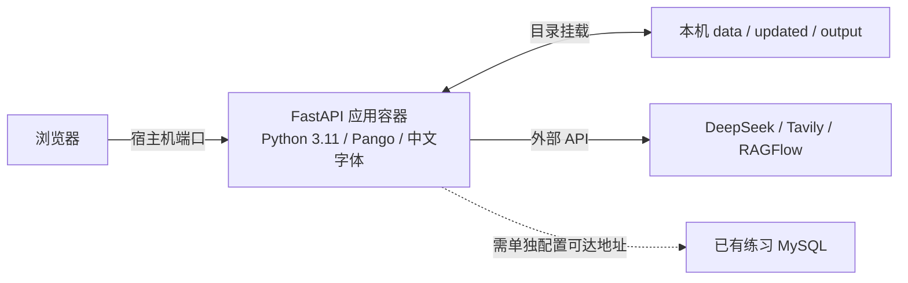

# MultiAgent Search

> **TraceAgent Lab · 第35～40步更新**：已新增任务级来源登记、答案/报告来源附录、读取范围元数据、独立task_id、SQLite任务账本、HTTP结果查询和前端断线恢复。新增模块为`api/evidence.py`与`api/task_store.py`；SQLite图检查点继续负责对话状态。来源目录不等于自动事实核验，结果查询不等于完整事件回放或自动续跑。实作教程见[第35步](30_第35步_文件读取范围与来源登记册.md)。


## 从一个问题，到一组智能体协作完成的答案

**设计思路 · 系统架构 · 技术路线 · 数据流 · 实现边界**

`Python 3.11` · `DeepSeek` · `deepagents` · `LangGraph` · `FastAPI` · `WebSocket`

以当前 **learning 学习版实际代码**为依据 · 更新于 **2026-10-17**


---

> **先用一句话理解这个项目**
>
> 用户在网页提出问题，主智能体选择合适的专业助手；助手调用搜索、数据库或知识库等工具取得信息；主智能体整理答案，必要时生成报告；网页通过实时事件看到执行过程，并下载当前会话的文件。

> **阅读约定**
>
> 本文解释已经存在的设计，不把后续规划写成已经实现。标记为“已验证”的内容有对应运行记录；“待验收”表示代码存在但完整路径尚未专项跑通；“受阻”表示当前外部服务条件不满足。具体差异见 [项目对照与未完成清单](项目对照与未完成清单.md)。

## 阅读导航

| 先建立整体认识 | 再理解运行机制 | 最后掌握工程边界 |
| --- | --- | --- |
| [01 项目要解决什么](#purpose) | [07 服务怎样启动和退出](#lifecycle) | [15 前端工作台的设计](#frontend) |
| [02 用一个团队理解角色](#roles) | [08 一次任务完整经历什么](#journey) | [16 失败、重试与清理](#errors) |
| [03 总体架构](#architecture) | [09 多智能体怎样协作](#agents) | [17 启动、配置与部署](#deployment) |
| [04 技术选型](#stack) | [10 工具怎样真正完成工作](#tools) | [18 验证到了哪一步](#verification) |
| [05 从零搭建的技术路线](#roadmap) | [11 数据库与知识库两条支线](#data) | [19 取舍与后续建设](#limitations) |
| [06 目录和模块分工](#files) | [12 会话、状态与记忆](#state) | [20 如何介绍这个项目](#presentation) |
|  | [13 上传、读取与报告文件](#documents) | [21 术语和源码阅读路线](#glossary) |
|  | [14 实时事件与异步通信](#events) | [22 理解检查与资料入口](#review) |

<a id="purpose"></a>
## 01 · 项目要解决什么

### 1.1 普通聊天与这个项目的差别

假设用户问：

> “先看我上传的运营规则，再查公开市场趋势，结合订单数据，帮我写一份分析报告。”

只做普通模型对话时，模型可能能组织出一段流畅文字，但它并不会因为你提到了“订单”就自动连上 MySQL，也不会因为你提到了“上传资料”就自动打开硬盘文件。

本项目把模型需要的能力拆成明确的程序接口：

| 用户想做的事 | 实际提供的程序能力 | 信息从哪里来 |
| --- | --- | --- |
| 查公开市场信息 | Tavily 搜索工具 | 互联网公开网页 |
| 查询练习订单 | 只读 SQL 工具 | 已配置的 MySQL |
| 查内部资料 | RAGFlow 聊天助手工具 | 外部知识库中的已解析资料 |
| 阅读上传文件 | 当前会话文件读取工具 | 本机的会话文件目录 |
| 做整数统计 | 数字统计工具 | 用户提供的数字串 |
| 生成报告 | Markdown 与 PDF 工具 | 主智能体整理后的内容 |

**模型负责选择和组织，工具负责实际操作，服务负责把结果交给用户。**

### 1.2 这个项目的定位

它是一个以学习为目的的、能从网页操作的多智能体应用，重点练习三件事：

1. **把模型接进程序。**模型不只是返回文字，还能提出结构化工具调用。
2. **让不同角色分工。**主助手协调，子助手在各自工具范围内完成任务。
3. **把执行变成应用体验。**有会话、有文件、有状态保存，也有执行过程和最终答案。

它调用已经存在的模型与外部服务，不包含基础大模型训练。本机 FastAPI 应用本身不需要训练用 GPU；RAGFlow 的模型与索引运行在哪里，取决于外部知识库服务的部署。

### 1.3 当前版本的功能边界

```text
输入：自然语言问题 + 可选上传资料 + 可选外部业务服务
                         ↓
           主助手分析 → 委派 → 工具取信息 → 整理
                         ↓
输出：文字回答 + 可选 Markdown/PDF + 会话文件下载 + 过程通知
```

这里的“可选”有实际含义：数据库连接失败或知识库 API 不可用时，该助手不会进入本次主图的业务助手名单。页面上的能力示例不代表所有外部服务都已在线。

<a id="roles"></a>
## 02 · 用一个研究团队理解各个角色

把项目想象成一个小型研究团队。比喻只帮助入门，下面每个角色都对应具体代码。

| 团队角色 | 项目中的对应物 | 真正负责的事 |
| --- | --- | --- |
| 接待台 | FastAPI 路由 | 接收问题、校验参数、接收文件、返回受理编号 |
| 项目负责人 | 主智能体 | 判断需求、选择助手、汇总信息、直接调用报告工具 |
| 市场研究员 | 市场情报助手 | 调用 Tavily 查公开资料 |
| 数据分析员 | 数据分析助手 | 使用只读工具查询 MySQL |
| 内部资料员 | 内部知识助手 | 通过 RAGFlow 查已有知识库 |
| 计算员 | 数字统计助手 | 调用 `sum_numbers` 计算整数统计 |
| 计算器、搜索接口、文件读写器 | 工具函数 | 执行确定的程序操作并返回数据 |
| 进度通知员 | `monitor` | 报告助手、工具、完成、失败等事件 |
| 通知收件人登记表 | `ConnectionManager` | 根据会话编号找到对应 WebSocket |
| 对话档案 | SQLite checkpointer | 保存执行图状态，按会话编号取回 |
| 每位用户的工作文件夹 | `output/session_{id}` | 放该会话读取或生成的磁盘文件 |

### 最容易混淆的一点

负责人可以说“请计算员统计这三个数”，但**说出这句话并没有算完**。实际计算发生在 `sum_numbers()` 中。

同样，通知员说“开始执行搜索工具”，也**没有替搜索工具执行搜索**。Tavily 请求由搜索工具发出，结果交给执行图，monitor 只负责告知过程。

<a id="architecture"></a>
## 03 · 总体架构：六层各做一件事



### 各层为什么要拆开

| 层 | 主要文件 | 为什么单独放一层 |
| --- | --- | --- |
| 展示层 | `api/static/index.html` | 页面样式和交互变化，不应该要求重写 SQL 工具 |
| 接口层 | `api/server.py` | HTTP 参数、文件传输与模型推理是不同职责 |
| 编排层 | `agent/main_agent.py`、`agent/subagents/` | 决定谁做什么，组织主子助手调用 |
| 能力层 | `tools/` | 真正搜索、查询、计算和写文件，便于单独验证 |
| 运行支撑层 | `api/context.py`、`api/monitor.py`、`utils/` | 统一处理会话、通知、路径、重试和转换 |
| 数据与服务层 | SQLite、会话目录、MySQL、RAGFlow、Tavily | 区分对话状态、文件和外部业务信息 |

这是一套**分层单体应用**：多个模块运行在同一个 Python 服务中。多个 Agent 不等于多个微服务，也不等于自动启动多个操作系统进程。

<a id="stack"></a>
## 04 · 技术选型：每个组件解决哪个问题

以下版本取自当前 [requirements.txt](requirements.txt)，是项目固定的直接依赖版本，不表示它们是上游最新版本。

| 技术 | 当前使用 | 选择它的作用 | 不应误解成什么 |
| --- | --- | --- | --- |
| Python | 独立 `.venv`，3.11 | 业务代码、异步服务、生态工具集成 | 终端显示 `.venv` 不保证你点运行时用的也是它 |
| DeepSeek 接口 | 通过本地配置指定模型 | 提供理解、工具选择、结果组织能力 | 不会自动访问本机文件或数据库 |
| LangChain | `1.2.10` | 模型适配、消息、工具等统一接口 | 不是另一个大模型 |
| `langchain-core` | `1.2.14` | `@tool`、消息与基础协议 | 不能替代实际工具实现 |
| deepagents | `0.4.3` | 组装主助手、子助手、规划与工具执行能力 | 不是自动完成所有业务规则的黑盒 |
| LangGraph | `1.0.9` | 执行图、节点状态、工具循环和检查点 | 图不是图片，而是可执行的流程结构 |
| SQLite checkpointer | `langgraph-checkpoint-sqlite 3.0.3` | 把图状态保存到本地 SQLite | 不是 MySQL 订单库，也不是向量知识库 |
| FastAPI | `0.129.2` | HTTP、WebSocket、参数校验、生命周期 | 不负责模型推理本身 |
| Uvicorn | `0.41.0` | 实际监听端口，运行 FastAPI 应用 | 创建 `app` 对象不等于服务已经监听 |
| Pydantic | 随依赖安装 | 校验请求中的 UUID 和字段类型 | 普通 Python 类型注解不会自动获得所有校验效果 |
| Tavily | `tavily-python 0.7.21` | 搜索公开网页并返回来源信息 | 不检索你的内部 MySQL |
| MySQL Connector | `9.6.0` | 用只读账号连接练习数据库 | 不是让模型拥有管理员权限 |
| RAGFlow SDK | `0.22.1` | 调用外部聊天助手和知识库能力 | 不代表本仓库已经实现自己的向量数据库 |
| 文档解析 | python-docx / pypdf / pandas / openpyxl | 分别读取 Word、文字 PDF、Excel | 不等于 OCR 或全格式无损解析 |
| 报告生成 | Markdown `3.10.2`、WeasyPrint `68.1` | Markdown → HTML → PDF | 与浏览器中的回答 Markdown 排版是两套实现 |
| 原生前端 | HTML / CSS / JavaScript | 无需前端构建即可由 FastAPI 提供页面 | 不是 React 或 Vue 项目 |
| Docker Compose | 应用容器配置 | 固定运行环境、挂载持久化目录 | 当前还没有把练习 MySQL 整合进同一份 Compose |

### 为什么通过 OpenAI 兼容接口调用 DeepSeek

[agent/llm.py](agent/llm.py) 使用 `init_chat_model(..., model_provider="openai")`，再从配置中指定 `base_url` 和 `model`。这里的 `openai` 表示采用该接口适配器，实际请求发到哪里由 `OPENAI_BASE_URL` 决定。

当前实现还传入 DeepSeek 的非思考模式参数。这个额外请求体是当前服务适配的一部分；如果以后换其他提供商，应重新核对兼容参数，不能只换地址就默认全部行为一致。

<a id="roadmap"></a>
## 05 · 从零搭建的技术路线

这条路线先排除环境和单个工具问题，再逐渐叠加编排、状态与页面。

| 阶段 | 学习目标 | 对应步骤 | 形成的能力 |
| --- | --- | --- | --- |
| ① 接通最小外部能力 | 固定解释器、配置模型、普通调用与工具调用 | 00～03 | 能确定是环境、配置还是外部 API 失败 |
| ② 建立主子助手 | YAML 配置、搜索助手、构建主图 | 04～06 | 第一次主模型 → 子助手 → 工具 → 主模型 |
| ③ 建立任务上下文 | 会话目录、ContextVar、路径工具、SQLite 生命周期 | 07～09 | 执行中的目录与对话状态有明确归属 |
| ④ 包成网页应用 | HTTP、后台任务、monitor、WebSocket、上传下载与页面 | 10～14 | 用户不用写 Python 也能提交任务 |
| ⑤ 接入业务分支 | MySQL、RAGFlow、重试、文档格式、PDF | 15～20 | 不同信息来源通过工具接进来 |
| ⑥ 验证稳定性 | 成功/失败/取消、连接更替、原子上传、恢复、Docker、联调 | 21～26 | 验证的不只是“能导入”，而是“真实任务能结束” |
| ⑦ 深化与扩展 | 专项真实委派、并发、下载、第四子助手、统一验收 | 27～34 | 从会复制变为能接线、能解释、能独立验证 |
| ⑧ 本轮工作台改造 | 更清晰的界面、恢复、重连、状态回归 | 前端验收脚本 35 | 把已有能力整理成可操作的研究空间 |

**进度提醒：**路线表表示学习安排，不表示每一步已经运行通过。第 27～32 步仍有待落地的专项示例；第 33 步数字助手与本轮前端真实链路已有通过记录。状态详见 [全过程概要](00_复刻全过程概要.md)。

<a id="files"></a>
## 06 · 目录与模块职责

```text
learning/                              ← 学习版项目根目录
├── agent/                             ← 模型与智能体编排
│   ├── llm.py                         ← 创建共享模型适配器
│   ├── prompts.py                     ← 把 YAML 读成 Python 字典
│   ├── rag_config.py                  ← 读取 RAGFlow 配置
│   ├── main_agent.py                  ← 建图、任务运行、SQLite 生命周期
│   └── subagents/
│       ├── network_search_agent.py    ← 市场情报助手
│       ├── database_query_agent.py    ← 数据分析助手
│       ├── knowledge_base_agent.py    ← 内部知识助手
│       └── number_agent.py            ← 数字统计助手
├── api/
│   ├── server.py                      ← 路由、上传下载、后台任务、lifespan
│   ├── context.py                     ← 当前任务目录和会话编号
│   ├── monitor.py                     ← 事件通知和 WebSocket 连接映射
│   └── static/index.html              ← 前端结构、样式、交互
├── tools/
│   ├── tavily_tool.py                 ← 搜索普通函数与模型工具入口
│   ├── db_tools.py                    ← 表列表、表预览、只读 SQL
│   ├── ragflow_tools.py               ← 助手列表、临时会话问答与清理
│   ├── number_tools.py                ← 整数统计
│   ├── upload_file_read_tool.py       ← 上传文件文字提取
│   ├── markdown_tools.py             ← 会话内 Markdown 写入
│   └── pdf_tools.py                   ← PDF 工具入口与参数检查
├── utils/
│   ├── path_utils.py                 ← 会话内路径解析与边界检查
│   ├── retry.py                      ← 同步函数指数退避重试
│   └── pdf_converter.py              ← Markdown/HTML/PDF 转换
├── prompt/prompts.yml                 ← 主助手与子助手规则
├── examples/                          ← 测试、阶段验收与学习运行入口
├── sql/init.sql                       ← 最小只读练习数据
├── data/checkpoints.db                ← 服务运行时创建的图状态数据库
├── updated/session_{uuid}/            ← 上传原件
├── output/session_{uuid}/             ← 复制的资料和生成文件
├── .env                               ← 本地真实配置；不写入文档或提交
├── requirements.txt                   ← 直接依赖版本
├── Dockerfile                         ← 应用镜像定义
├── docker-compose.learning.yml        ← 应用启动、端口与目录挂载
└── README.md                          ← 日常启动入口
```

### 三个容易放错位置的东西

- **正式能力**放在 `tools/`、`agent/` 或 `api/`，供系统导入。
- **验证入口**放在 `examples/`，运行它来证明正式能力是否正确，不让服务器依赖测试脚本。
- **用户运行文件**放在 `updated/` 和 `output/` 的会话目录，不与源码混放。

<a id="lifecycle"></a>
## 07 · 服务怎样启动、运行与退出

### 7.1 启动不是一个动作，而是几个阶段



### 7.2 关键函数的区别

| 对象或函数 | 谁调用它 | 什么时候执行 | 做什么 |
| --- | --- | --- | --- |
| `build_model()` | `agent/llm.py` 导入过程 | 服务导入模块时 | 读取配置并创建模型适配对象；不是在此生成用户答案 |
| `load_yaml()` | `agent/prompts.py` 导入过程 | 模块导入时 | 读取主助手和子助手规则 |
| `lifespan(app)` | FastAPI | 启动前进入，关服后退出 | 组织整个服务的资源生命周期 |
| `agent_runtime()` | `lifespan()` | 服务启动阶段进入 | 打开 SQLite、调用建图函数、退出时释放资源 |
| `build_main_agent(checkpointer)` | `agent_runtime()` | 每次进入运行生命周期时 | 根据可用服务名单创建执行图 |
| `run_deep_agent(query, id)` | 后台 `execute_task()` | 每次用户任务到来时 | 准备目录与上下文，再实际执行主图 |

### 7.3 用“开门营业”理解 yield

`agent_runtime()` 可以理解为租用一间工作室：进入时打开 SQLite 和准备主图；执行到 `yield main_agent`，把已经准备好的图交给外面的代码使用，数据库连接保持打开；外面的 `async with` 代码块结束后，函数从 `yield` 后继续，清空图引用，再退出 SQLite 上下文关闭连接。

FastAPI 的 `lifespan()` 也有类似三段：

```text
启动前：准备资源
→ yield 暂停：FastAPI 在这段期间持续处理请求
→ 关服后：取消任务、等待退出、关闭资源
```

`lifespan` 是服务启动和关闭时调用的资源管理函数。真正接收请求的应用对象是 `app = FastAPI(...)`，真正监听端口的是 Uvicorn。

### 7.4 为什么不每次问题都重新开数据库和建图

一条用户问题只需要执行已有主图。若每次提问都重复建图、探测 MySQL/RAGFlow，会增加开销，也更难组织资源退出。当前设计是**服务生命周期内共用主图对象，按会话编号选择不同状态**。

共用图不表示所有用户共用一份聊天记录；聊天状态由后续 `config.configurable.thread_id` 区分。不过，同一编号同时提交多个任务仍缺后端串行控制，不能把“图可共用”理解为“任何并发方式都没问题”。

<a id="journey"></a>
## 08 · 一次任务完整经历什么

### 8.1 贯穿案例：数字统计

本例输入：

> “请委派数字统计助手，用工具计算 10,20,30 的数量、合计和平均值。”

预期结果：数量 3、合计 60、平均值 20。这个路径已有真实验证记录，适合从头追踪。

### 8.2 完整时序图



> 图中 `M → S` 的委派和 `S → T` 的执行由框架组织；不是 monitor 在调度。图中箭头描述逻辑关系，不代表每一条都启动一个新线程。

### 8.3 逐段对应真实函数

**第一段：浏览器先接通通知通道。**

前端 `connectSession()` 按会话编号连接 `/ws/{thread_id}`。先连接再提交，可以减少错过初始事件的机会。即便如此，当前也没有服务器离线补发能力。

**第二段：提交问题，得到受理结果。**

`submit_task(request)` 从请求中取 `query` 与 `thread_id`；没有编号时生成 UUID。它调用 `asyncio.create_task(execute_task(...))`，保留任务引用，然后立即返回 `started`。

`started` 的准确含义是“任务已安排”，不是“模型回答完了”。

**第三段：后台准备当前会话。**

`run_deep_agent()` 创建 `output/session_{id}`，把已上传文件从 `updated/session_{id}` 复制过来；构造文件提醒；设置当前目录和编号的 ContextVar；准备检查点配置。

**第四段：运行主图。**

`main_agent.astream(..., stream_mode="updates")` 开始执行。主模型的消息可能有 `tool_calls`，也可能只有文字。出现 `task` 调用时，框架去运行对应子助手。

**第五段：子助手选择工具，工具真正计算。**

`sum_numbers("10,20,30")` 把文本拆成三个整数，再执行确定的 Python 运算。大模型负责决定调用和组织参数，结果中的 60 来自代码求和。

**第六段：图结束后只报告一次最终答案。**

主图运行循环不断收集最后的有效文字，待流结束再报告 `task_result` 并返回。若没有文字结果，当前代码会报错，不把空字符串当作成功。

**第七段：浏览器展示，并恢复可输入状态。**

前端收到 `task_result` 后添加助手消息、标记完成、刷新当前任务所属会话的文件列表。后台任务结束时，`running_tasks.discard` 回调移除已完成任务引用。

<a id="agents"></a>
## 09 · 多智能体怎样协作

### 9.1 一个子助手最关键的四项配置

以数字助手为例，实际配置位于 [agent/subagents/number_agent.py](agent/subagents/number_agent.py)：

```python
number_agent = {
    "name": number_config["name"],
    "description": number_config["description"],
    "system_prompt": number_config["system_prompt"],
    "tools": [sum_numbers],
}
```

| 字段 | 本例的含义 | 谁主要使用它 |
| --- | --- | --- |
| `name` | 数字统计助手的委派名称 | 主图的委派机制 |
| `description` | “我长期擅长处理哪些任务” | 主模型选择助手时参考 |
| `system_prompt` | “接到任务以后应该怎样做” | 子助手自己的模型执行过程 |
| `tools` | “接到任务以后实际允许调用哪些业务工具” | 子助手的工具执行流程 |

`number_agent` 是配置字典。创建这个字典时，`sum_numbers` 没有因为放进列表就自动执行。

### 9.2 主助手和子助手怎样交接

主模型可能提出这样的调用。下面是结构示意，不是要求你手动发给 HTTP 接口的请求：

```python
{
    "name": "task",
    "args": {
        "subagent_type": "数字统计助手",
        "description": "计算 10,20,30 的数量、合计和平均值，返回工具的实际结果。"
    }
}
```

这里的 `description` 是**本次交给助手的具体任务**，不同于子助手配置里介绍长期能力的 `description`。

运行关系是：

```text
主模型提出 task
→ 框架找到 subagent_type 对应的子助手
→ 给子助手本次任务
→ 子助手的模型选择 sum_numbers
→ 框架执行实际 Python 工具
→ 工具返回数据给子助手
→ 子助手把结果交回主图
→ 主图继续判断是否需要其他信息，或生成最终答案
```

### 9.3 当前四种业务助手

| 助手 | 核心工具 | 注册条件 | 例子 |
| --- | --- | --- | --- |
| 市场情报助手 | `internet_search` | 构图时加入；真实搜索仍要求 Tavily 可用 | 查公开市场趋势 |
| 数字统计助手 | `sum_numbers` | 构图时加入，无额外业务服务 | 统计 `10,20,30` |
| 数据分析助手 | `list_sql_tables`、`get_table_data`、`execute_sql_query` | 有配置且启动连接探测成功 | 查询订单金额 |
| 内部知识助手 | `get_assistant_list`、`create_ask_delete` | RAGFlow 能列出至少一个聊天助手 | 查内部规则 |

“第四个助手”表示第四种自定义业务助手配置，不保证四种在每次启动时都同时在线。

### 9.4 它们不是四台独立训练的大模型

当前自定义子助手没有逐个配置不同的模型。它们主要依靠不同的提示词、任务输入和工具范围形成分工，底层可复用共享模型适配器。

例如数字助手只有数字统计业务工具，不需要获得 MySQL 的连接权限；数据库助手能够调用 SQL 工具，也不意味着它可以任意执行硬盘命令。

### 9.5 框架默认能力与项目业务能力要区分

当前 `create_deep_agent` 除了接收显式业务工具和子助手，也会按 deepagents 的默认机制加入规划、文件等能力，以及通用子助手。因此：

- 四种自定义助手不一定等于整个运行图中的全部助手。
- 主助手的自定义工具列表不一定等于它看到的全部框架工具。
- `task` 属于框架提供的委派入口，项目没有自己实现一个同名普通搜索函数。

**特别提醒：两种“文件”不是天然同一处。**当前建图没有指定磁盘文件 backend；本机安装的 deepagents `0.4.3` 默认使用 `StateBackend`。框架默认 `read_file`、`write_file` 面向该 backend 的文件状态，不应直接理解成会写入 `learning/output/`。本项目真正把报告写到磁盘、供下载 API 读取的是自定义 `generate_markdown`、`convert_md_to_pdf` 等工具。

所以“框架的文件工具执行成功”不等于“网页文件列表里一定出现磁盘文件”。要生成可下载成果，应走项目明确的业务工具链路。

<a id="tools"></a>
## 10 · 工具怎样真正完成工作

### 10.1 模型只能提出调用，实际工作由程序执行

`@tool` 把普通函数组织成模型可以理解的工具接口：工具名、说明、参数结构等。它本身不会让函数在定义时运行。

| 阶段 | 数字工具实例 | 此时有没有算出结果 |
| --- | --- | --- |
| 定义 | 写出 `def sum_numbers(numbers: str)` | 没有 |
| 装配 | 放进 `number_agent["tools"]` | 没有 |
| 模型决策 | 子模型提出 `sum_numbers(numbers="10,20,30")` | 尚未执行 Python 运算 |
| 框架执行 | 实际调用工具对象对应函数 | 开始计算 |
| 工具返回 | 返回数量、合计、平均值字符串 | 已有确定结果 |
| 模型整理 | 主子助手组织自然语言 | 对工具结果进行表达 |

### 10.2 各工具模块的职责

| 模块 | 对模型暴露的主要工具 | 普通辅助函数 | 重要边界 |
| --- | --- | --- | --- |
| [tavily_tool.py](tools/tavily_tool.py) | `internet_search` | `search_web` | 只对指定网络异常重试 |
| [db_tools.py](tools/db_tools.py) | `list_sql_tables`、`get_table_data`、`execute_sql_query` | `get_db_config`、`rows_to_csv` | 只读账号、单条 SELECT、结果行数限制 |
| [ragflow_tools.py](tools/ragflow_tools.py) | `get_assistant_list`、`create_ask_delete` | `get_ragflow_client`、`ask_chat_and_cleanup` | 面向已有聊天助手；临时会话要清理 |
| [number_tools.py](tools/number_tools.py) | `sum_numbers` | 无单独外部服务 | 1～20 个整数，格式或数值过大时明确返回错误 |
| [upload_file_read_tool.py](tools/upload_file_read_tool.py) | `read_file_content` | `extract_file_text` | 当前会话内文件，有限页数/行数/字符数 |
| [markdown_tools.py](tools/markdown_tools.py) | `generate_markdown` | 调用共享路径函数 | 内容非空，写入当前会话 |
| [pdf_tools.py](tools/pdf_tools.py) | `convert_md_to_pdf` | 调用 `render_pdf` | 已存在的 Markdown 源文件和 PDF 输出名 |

### 10.3 为什么拆成“普通函数 + 工具入口”

搜索模块就是例子：`search_web()` 负责调用 SDK 并套用重试；`internet_search()` 负责对模型暴露接口并报告开始事件。

这样可以分别验证：

- 普通函数能否收到 Tavily 的真实数据。
- 工具对象参数是否正确。
- 子助手是否实际选择了这个工具。
- 主图是否把工具结果整理进答案。

这四种测试不是同一件事。

<a id="data"></a>
## 11 · 数据库与知识库：两条不同的信息路径

### 11.1 MySQL：从结构化数据中计算精确结果

```text
用户：“按品类汇总订单金额”
→ 数据分析助手先了解表
→ 执行 SELECT category, SUM(total_amount) ... GROUP BY category
→ MySQL 计算结果
→ 工具把列名与结果组织成 CSV
→ 模型解释这些数字
```

当前练习 `orders` 表只有 `id`、`category`、`total_amount` 三列和三条样本，适合学习品类汇总。提示词中的“库存、用户行为”等业务描述，不代表当前数据库真的包含这些表。

只读分为几层：账号权限限制、Python 工具限制、只读事务。工具只获取有限结果行数；它不是通用数据库管理界面。

### 11.2 RAGFlow：从已整理的文档中寻找依据

RAG 的基本思路可以理解为：**先从资料里找相关片段，再让模型带着这些片段回答。**

外部知识库通常需要准备资料、解析切分、建立检索索引，再配置关联聊天助手。具体模型、向量存储和检索策略由 RAGFlow 服务配置决定，不是本仓库自行实现或固定的。

本项目接入的位置是：

```text
RAGFlow 已有数据集与聊天助手
→ SDK 列出聊天助手
→ 选择 chat_name
→ 创建本次临时 session
→ ask 提问并取得文字
→ finally 删除本次临时 session
→ 把答案交回主图
```

### 11.3 三种“文件”来源一定要分开

| 来源 | 放在哪里 | 当前应用怎样使用 |
| --- | --- | --- |
| 本网页上传资料 | 本机 `updated/`、之后复制到 `output/` | 用 `read_file_content` 直接提字 |
| RAGFlow 知识文档 | 外部 RAGFlow 数据集 | 用其聊天助手检索 |
| 模型生成报告 | 当前会话 `output/` | 用文件列表和下载接口取得 |

**网页上传文件不会自动进入 RAGFlow 数据集。**这既不是当前前端偷偷执行的功能，也不是读取工具的隐含副作用。

### 11.4 当前知识库受阻在哪里

已有记录显示，在线 RAGFlow 账户调用列表接口受到 API 套餐权限限制。程序因此没有把内部知识助手注册进主图。

这属于外部服务门槛未满足；不是“RAG 工具忘记写了”。后续应先取得可用 API 权限和已解析资料，再做真实提问与清理验收。

<a id="state"></a>
## 12 · 会话、状态与记忆：五种存储不要混用

### 12.1 用 A、B 两位用户代入

下文把两条会话简称 A、B。真实 HTTP 参数应是 UUID，例如：

```text
A = 8ba0912f-153b-4f36-bacf-359547fc6ad1
B = 95f4682a-9c33-46d5-bc43-765079aac52a
```

同一个 A 编号被用在几个地方，但每个地方解决不同问题：

| 存储 | 保存的东西 | 生命周期 | 谁来读取 | 它不负责什么 |
| --- | --- | --- | --- | --- |
| ContextVar | 当前执行链的会话目录、编号 | 本次任务执行期间 | 文件工具、monitor | 不保存长期聊天记录 |
| SQLite checkpointer | LangGraph 图状态和消息等 | 保存后可跨运行连接保留 | 执行图 | 不保存 WebSocket 连接对象 |
| `updated/` 与 `output/` | 上传原件、复制资料、报告 | 磁盘文件未删除期间 | 读取、生成、文件接口 | 不自动成为 RAGFlow 索引 |
| manager 的内存字典 | 编号 → 当前 WebSocket 对象 | 当前服务进程与连接期间 | 事件发送逻辑 | 不补发已经丢失的事件 |
| 浏览器 localStorage | 页面会话列表、显示消息、草稿和事件摘要 | 当前浏览器未清理期间 | 前端恢复函数 | 不提供跨浏览器的服务端历史 |

另有 `running_tasks` 集合保存后台任务对象引用，属于运行中的资源管理，不是聊天档案。

### 12.2 ContextVar 为什么存在

假设 A 的读取工具没有 `session_id` 参数，它只接收 `filename="规则.txt"`。工具仍需要知道“是 A 的规则，还是 B 的规则”。

`run_deep_agent()` 在执行前设置当前任务上下文：A 的执行链读到 A 的目录，B 的执行链读到 B 的目录。文件工具通过 `get_session_context()` 获取它，而不用层层手动传目录参数。

这可以减少当前执行链中全局变量互相覆盖的问题。但它不会检查 HTTP 请求是否属于某个真实登录用户；也不会阻止两个任务同时使用同一个会话编号。

### 12.3 Token 是“恢复凭条”，不是 API 密钥

```python
session_token = set_session_context(str(session_dir))
thread_token = set_thread_context(session_id)
try:
    # 执行当前任务
    ...
finally:
    reset_session_context(session_token, thread_token)
```

这里的 `Token` 是 ContextVar 设置时返回的恢复凭条，记住设值前的状态。它不是要保密的模型 API Key。`reset` 表示恢复之前的上下文，不是删除文件，也不是清空 SQLite 对话。

### 12.4 thread_id 与 session_id 在这里的关系

`run_deep_agent(task_query, session_id)` 中的 `session_id`，放进 LangGraph 配置时叫 `thread_id`；在网页接口中也叫 `thread_id`。当前它们表示同一条会话编号。

这个编号不是操作系统线程号。第37～39步已区分两种ID：thread_id关联整段会话，task_id关联其中一次提交；对话检查点仍按thread_id保存，任务结果按task_id记录。

### 12.5 两种“记忆”的区别

- **对话状态记忆：**SQLite 让执行图按 A 的编号取回 A 过去的状态。
- **资料知识记忆：**RAGFlow 对已解析资料建立检索能力。

把历史对话存在 SQLite，不等于训练了模型；把文件复制到 `output/`，也不等于建立了向量检索库。

<a id="documents"></a>
## 13 · 上传、读取与报告文件怎样流转

```mermaid
flowchart LR
    A["浏览器选择资料"] --> B["POST /api/upload\nUUID + 单个 file"]
    B --> C["同目录临时文件\n检查大小后 os.replace"]
    C --> D["updated/session_A\n上传原件"]
    D -->|任务开始时 copy2| E["output/session_A\n任务工作目录"]
    E --> F["read_file_content\n提取文字"]
    F --> G["主图依据文字回答"]
    G -->|用户需要报告| H["generate_markdown\n写入报告.md"]
    H -->|用户需要 PDF| I["convert_md_to_pdf\n写入报告.pdf"]
    H --> J["GET /api/files"]
    I --> J
    J --> K["GET /api/download\n返回当前会话文件"]
```



### 13.1 为什么上传先写临时文件

如果用户重复上传同名文件，直接打开目标文件写入时，旧文件可能先被清空，然后才发现新文件超限或传输中断。

当前流程在目标目录里创建临时文件，分块读取、累计字节数，完整写完后才用 `os.replace` 替换目标。超限或中断时清理临时文件，旧同名文件可以保留。

当前后端一条请求接收一个文件；新版网页的多选上传是循环发多条请求，不是已经改成原版的批量 HTTP 协议。

### 13.2 上传成功不等于模型已读

复制完成后，程序只是在用户问题后增加“当前会话有哪些文件，请先读取”的提醒。模型拿到的是文件名和规则，不是自动收到全部文件正文。

实际读取发生在 `read_file_content` 被执行之后。因此验收需要看读取工具事件，再检查答案是否基于文件。

### 13.3 当前提取范围

| 格式 | 现在怎么读 | 应理解的范围 |
| --- | --- | --- |
| TXT / MD | UTF-8 文本 | 最终工具返回仍有字符数上限 |
| DOCX | `Document(...).paragraphs` | 主要取普通段落，不包含完整复杂表格结构 |
| PDF | `PdfReader` 提取文字 | 只取前 20 页；没有 OCR |
| XLSX | pandas 读首个 sheet、最多 100 行 | 输出列名、读取行数和前 10 行预览，不等于整表统计 |
| 工具最终文字 | `text[:12000]` | 超过12,000字符会截断；第35步已返回范围元数据和明确提示 |

扫描 PDF 只有图像、没有可提取文字时，本工具不能凭空读懂扫描内容。若用户要分析全表或后续页，应增加分页读取或专门分析能力，不能从前几行预览猜测整个文件。

### 13.4 路径检查怎样帮忙

`resolve_session_file(filename)` 从 ContextVar 找当前目录，拒绝绝对路径；对拼接路径做 `resolve()` 后确认仍处于当前会话目录中。这样读取和生成工具不会因为收到 `../其他目录` 就跨出会话工作区。

下载接口也按 `thread_id + filename` 解析输出目录，不要求浏览器传服务器绝对路径。UUID 格式校验和路径检查仍不等于用户身份认证。

### 13.5 PDF 的技术路径

```text
Markdown 磁盘文件
→ Python Markdown 转 HTML
→ 添加基本表格与字体样式
→ WeasyPrint 排版成 PDF
→ 保存到同一会话目录
```

`deny_external_resource()` 拒绝转换时加载外部资源，当前转换器不是任意网络网页抓取器。容器安装 Pango 等渲染库与中文字体；本机有单独的 Homebrew 动态库适配。

**生成成功、文字可提取、页面排版正确是三种检查。**已有容器中文提取通过记录，但长文分页和复杂排版仍应打开实际 PDF 人工核对。

<a id="events"></a>
## 14 · 实时事件与异步通信

### 14.1 两条通道分工

| 通道 | 适合做什么 | 本项目例子 |
| --- | --- | --- |
| HTTP | 一次请求、一次响应 | 提交问题、上传文件、列文件、下载文件 |
| WebSocket | 同一个连接持续收更新 | 哪个助手被委派、哪个工具开始、任务完成或失败 |

HTTP 的受理响应很快结束；WebSocket 则继续等后台任务的过程与结果。因此浏览器不能只看 POST 返回 `started` 就显示“完成”。

### 14.2 当前监控事件

| event | 由谁触发 | 前端怎样使用 | 不能推断什么 |
| --- | --- | --- | --- |
| `session_created` | 主任务准备完工作目录 | 显示任务已开始 | 不能证明模型已回答 |
| `assistant_call` | 主图观察到 `task` 调用 | 显示助手名与本次委派说明 | 不能证明子助手任务已完成 |
| `tool_start` | 工具函数执行前报告 | 显示工具名和精简参数 | 不能证明工具成功返回 |
| `task_result` | 主图流结束且有有效答案 | 展示回答、标记完成、刷新文件 | 不保证答案中所有事实都经过独立验证 |
| `error` | 失败处理或明确错误报告 | 展示错误与详情 | 与“工具返回错误字符串”不是完全相同的信号 |
| `task_cancelled` | 主任务收到取消 | 展示取消状态 | 不表示已经有用户取消按钮/API |

事件结构示意：

```json
{
  "type": "monitor_event",
  "event": "tool_start",
  "message": "开始执行工具：sum_numbers",
  "data": {
    "tool_name": "sum_numbers",
    "args": {"item_count_hint": 3}
  },
  "timestamp": "2026-10-17T10:00:00"
}
```

示例时间和参数只用于说明结构。事件参数不应塞入 API 密钥、完整上传文件或长篇报告正文。

### 14.3 loop 从哪里来，到底负责什么

Uvicorn 运行异步服务时有一个事件循环。可以把它看成同一线程里的“工作安排台”：哪项异步任务可以继续、哪项暂时等网络，就由它轮流安排。

服务进入 `lifespan()` 时调用 `asyncio.get_running_loop()`，取得当前正在运行的循环，存到 `manager.loop`。WebSocket 连接也由这个服务循环管理，所以通知发送要交给它。

`monitor._emit()` 可能被主图直接调用，也可能在同步工具所在的工作线程里调用。它区分两种情况：

| 通知从哪里来 | 怎么安排发送 |
| --- | --- |
| 当前代码就在 `manager.loop` | `current_loop.create_task(coroutine)` |
| 当前代码不在该循环，例如另一个线程 | `asyncio.run_coroutine_threadsafe(coroutine, manager.loop)` |

这不是在两个循环里随便挑一个发消息，而是把 WebSocket 发送交回管理该连接的循环。

`create_task` 安排协程执行，不会自动创建新操作系统线程；`run_coroutine_threadsafe` 是从其他线程安全提交到目标循环，也不是要求另一个线程直接操作浏览器。

### 14.4 安排发送和发送成功怎样区分

`_emit()` 返回事件 payload 时，网络发送可能还没有结束。当前实现给发送任务添加完成回调 `_observe_delivery`，之后才检查：发送是否成功、是否没有连接、是否抛出异常。

即使 WebSocket 的发送调用成功，也不等于已经证明用户阅读了答案。当前浏览器测试另外验证了页面内容，才形成“网页确实收到并展示”的证据。

<a id="frontend"></a>
## 15 · 前端工作台：让执行过程变得看得懂

### 15.1 为什么采用现在的布局

新版页面将原本混在一起的内容分为三块：

| 区域 | 放什么 | 用户获得什么 |
| --- | --- | --- |
| 左侧会话栏 | 会话摘要、任务状态、新建与关闭 | 在多个研究任务之间切换 |
| 中间研究区 | 用户问题、最终答案、输入与上传标签 | 专注理解问题和结果 |
| 右侧辅助区 | 执行时间线、文件列表、上传区域 | 知道现在做到了哪一步，找到成果 |

视觉上采用深绿侧栏、浅色工作区与低饱和绿色强调；用真实状态和内容形成信息层次，不使用假进度百分比或虚构的“助手全部在线”。手机上将会话栏收进抽屉，辅助区放到对话区下面。



*图为新版工作台空状态。界面能力示例用于填入问题，不代表全部外部服务已配置。*

### 15.2 前端状态不是只有一个字符串

每个会话有自己的记录：

```text
session
├── id / title / createdAt         会话身份与显示标题
├── messages                       用户问题、助手最终回答
├── events                         执行动态的精简记录
├── draft                          尚未提交的问题
├── uploads / files                已上传名称、当前输出文件列表
├── status                         任务状态
├── connection                     WebSocket 状态
├── socket / connecting            当前连接对象、连接中的 Promise
└── retryTimer / heartbeat         重连和心跳资源
```

`status="done"` 与 `connection="offline"` 可以同时成立：任务已经完成，但通知连接后来断开。若把二者混成同一个状态，就可能把断线误报成任务失败，或者把任务完成误报成始终在线。

### 15.3 任务状态如何变化



页面刷新时先把未确认任务标记为“状态待确认”，再通过第38步任务接口查询SQLite账本。查到成功后恢复答案和来源，查到中断则如实显示；中间执行事件仍不会全部补发。

### 15.4 关键交互怎样连接后端

| 前端函数 | 职责 | 后端连接点 |
| --- | --- | --- |
| `openSession()` | 创建本地会话记录和 UUID | 准备连接 `/ws/{id}` |
| `connectSession()` | 建立通知连接、心跳、异常重连 | WebSocket 路由 |
| `sendTask()` | 提交当前问题、限制重复点击 | `POST /api/task` |
| `receiveEvent()` | 按事件更新正确会话的状态与内容 | monitor payload |
| `uploadFiles()` | 检查格式、大小，逐个上传 | `POST /api/upload` |
| `refreshFiles(id)` | 获取指定会话文件，避免切换后串线 | `GET /api/files` |
| `renderMarkdown()` | 用 DOM 排版答案 | 不调用模型，也不执行答案里的 HTML |
| `persistSessions()` / `restoreSessions()` | 保存与恢复本地页面记录 | 浏览器 localStorage，不是后端历史接口 |

### 15.5 状态边界中的几个实际处理

- **多个标签页：**同一会话在后端只保留一个当前 WebSocket。收到正常关闭时，旧页面停止自动争抢，允许用户手动重连。
- **回执竞态：**WebSocket 可能比 HTTP 回执更早送达结果。若最终答案已经确认，后来的回执解析错误不应把完成状态改回未知。
- **文件刷新竞态：**旧的文件列表请求还在进行时，如果任务完成又触发刷新，记录一次待刷新，避免新文件长期不出现。
- **安全排版：**只创建文本节点、表格等明确元素，链接限制为 HTTP(S)，不把模型原始 HTML 直接写进 `innerHTML`。
- **关闭会话：**移除的是浏览器本地记录，不是删除服务器文件，也不是取消后台任务。

<a id="errors"></a>
## 16 · 失败、重试与清理

### 16.1 三种失败不走完全相同的路径

| 发生在哪里 | 例子 | 当前处理 |
| --- | --- | --- |
| 请求入口 | UUID 无效、文件名非法、上传超限 | FastAPI 校验或 HTTP 错误响应 |
| 工具执行 | 文件不存在、SQL 不被允许 | 许多工具返回明确错误字符串，由模型继续解释或处理 |
| 主图执行 | 模型 API 异常、图执行异常、最终没有文字 | monitor 报告错误，异常继续交给上层后台任务 |

工具返回“错误：文件不存在”仍是一次正常返回的工具消息，不一定让整个主图抛异常。所以只看任务最后有一段文字，也不能证明所有工具都成功；需要看任务内容和工具结果。

### 16.2 搜索重试的准确含义

当前搜索装饰器设置 `max_retries=2`，表示**首次尝试加两次重试，最多三次调用**。如果第一次、第二次都是指定的超时或连接异常，等待大致为：

```text
第 1 次尝试失败 → 等 0.2 秒
第 2 次尝试失败 → 等 0.4 秒
第 3 次尝试 → 成功返回，或把原异常抛出
```

它不是对所有错误都盲目重试；配置错误、权限错误通常不属于这里的可恢复网络故障。`retry.py` 使用同步 `time.sleep`，应理解为同步工具的等待机制，而不是在 FastAPI 主循环里随意写阻塞睡眠。

### 16.3 清理为什么要放在 finally

| 资源 | 何时取得 | 何时释放或恢复 |
| --- | --- | --- |
| 当前会话 ContextVar | 主任务开始前 | `run_deep_agent()` 最外层 finally |
| SQLite 连接 | 进入 `agent_runtime()` | 离开异步数据库上下文 |
| RAGFlow 临时会话 | 本次知识库提问时 | `ask_chat_and_cleanup()` 的 finally 中尝试删除 |
| 上传临时文件 | 接收文件时 | 成功替换，或异常/取消时删除 |
| 后台任务引用 | `create_task` 后 | 完成回调从集合移除；关服取消并等待 |
| 浏览器心跳与重连计时器 | 创建连接时 | 连接关闭或移除会话时清理 |

不能只考虑成功路径。比如知识库问答超时后，如果没有 finally，临时聊天会话可能不断积累。

<a id="deployment"></a>
## 17 · 启动、配置与部署路线

### 17.1 本机运行

本次已将最新版启动在 **http://127.0.0.1:8001/**，接口文档为 **http://127.0.0.1:8001/docs**。前端由同一个 FastAPI 应用提供，不需要另外启动 npm 开发服务。

下面命令供以后重新启动时使用；同一端口已有服务时，不要重复启动第二个监听进程。

从外层 `ai agent 学习项目1` 目录运行：

```bash
learning/.venv/bin/python -m uvicorn api.server:app --app-dir learning --host 127.0.0.1 --port 8001
```

或先进入 `learning` 目录：

```bash
.venv/bin/python -m uvicorn api.server:app --host 127.0.0.1 --port 8001
```

`--app-dir learning` 让 Python 找到 `agent`、`api`、`tools` 等项目包。独立示例脚本如果直接运行，通常在开头把 `learning` 根目录加入 `sys.path`；这就是之前遇到 `No module named agent/tools` 时需要解决的搜索路径问题。

### 17.2 配置项只记录名字

| 分组 | `.env` 键名 | 用途 |
| --- | --- | --- |
| 模型 | `OPENAI_BASE_URL`、`OPENAI_API_KEY`、`LLM_QWEN_MAX` | 服务地址、凭据、模型名；最后一个是沿用的历史键名 |
| 搜索 | `TAVILY_API_KEY` | Tavily API 凭据 |
| 数据库 | `MYSQL_HOST`、`MYSQL_PORT`、`MYSQL_USER`、`MYSQL_PASSWORD`、`MYSQL_DATABASE` | 只读练习数据库连接 |
| 知识库 | `RAGFLOW_API_URL`、`RAGFLOW_API_KEY` | 外部 RAGFlow 服务 |

`.env` 保留在本地，不把真实值写进学习文档、源码或截图。模型和 Tavily 当前在模块导入时就检查配置；“数据库/RAGFlow 可选”不代表整个项目完全不需要外部 API 配置。

### 17.3 当前应用容器



当前 `docker-compose.learning.yml` 只有 app 服务；不会自动启动配套 MySQL。练习 MySQL 目前是独立容器，已有运行记录，但应用容器与数据库的联合配置仍待完善。

从 `learning` 目录启动应用容器：

```bash
docker compose -f docker-compose.learning.yml up --build -d
```

若本机 8001 已用于直接运行的服务，可以明确用 8002：

```bash
LEARNING_HOST_PORT=8002 docker compose -f docker-compose.learning.yml up --build -d
```

容器内的 `127.0.0.1` 指向容器自己，不是 Mac；所以本机 SQL 工具通过，不等于 app 容器的 SQL 工具也通过。

### 17.4 当前部署取舍

应用镜像安装 Python 依赖、Pango 渲染库和中文字体；`.dockerignore` 排除本地密钥、虚拟环境和运行数据。SQLite、上传和输出通过目录挂载持久化。

当前缺少健康检查、自动重启策略与完整数据库联合编排；`requirements.lock.txt`已包含完整解析版本；其他平台的系统依赖与外部服务仍需分别验证。

<a id="verification"></a>
## 18 · 现在究竟验证到了哪一步

### 18.1 必须区分的证据等级

```text
能导入
  < 工具单独运行正确
  < 主子助手真实委派正确
  < HTTP/WebSocket 全流程正确
  < 多会话、重开恢复、失败路径也正确
```

这个顺序用于提醒验证范围，不是说所有场景都必须重复每个层级。一次单会话成功，不能代替多会话隔离验收；一份文字 PDF 成功，也不能代替全部扫描文档解析。

### 18.2 已有记录

| 内容 | 已观察到的证据 | 覆盖边界 |
| --- | --- | --- |
| 模型与 Tavily 直接调用 | 真实非空回复与搜索结果 | 不代替主图真实搜索委派的专项验收 |
| 数字工具 | 11 组正常/边界/错误输入通过 | 包括空串、非法整数、项数上限和过大整数 |
| 数字助手委派 | 助手事件 → `sum_numbers` → 最终 3、60、20 | 真实模型路径通过 |
| 单会话上传读取 | 上传、读取工具事件、正确代号、文件列表 | 第 26 步真实联调通过 |
| 容器服务 | 首页和 `/docs` HTTP 200，真实上传读取通过 | 不是所有外部服务都在容器中通过 |
| PDF 基础转换 | 容器生成并提取中文文字 | 长文排版和完整报告下载专项仍待补 |
| 数据库工具 | 主机只读查询返回练习汇总 | 尚不能宣称主图真实数据库委派通过 |
| 前端真实浏览器 | 数字委派、上传资料、读取、回答、下载正文核对、刷新恢复 | 使用当前后端真实执行 |
| 前端模拟回归 | 多会话、草稿、异常消息、重连、接管、回执竞态、失败、清理、手机布局 | 模拟通信，未用它冒充外部 API 真查询 |

### 18.3 仍待完成或受阻

- **真实搜索主子委派：**已有工具和助手，专门的第 27 步示例尚未落地。
- **严格 A/B 检查点与并发恢复：**不能仅打印消息数量，第 24/28 步专项仍待补齐。
- **数据库主图委派与容器接入：**工具直接查询不等于从网页委派成功。
- **RAGFlow：**需要读者配置有API权限的服务，再验证真实知识库任务和清理。
- **完整报告生成与 PDF 下载：**本轮已通过上传文本下载，但不代替第 31 步 PDF 报告全闭环。
- **真实网络接班专项和统一验收记录：**模拟前端回归不代替所有服务端连接边界检查。

具体文件和完成标准见 [项目对照与未完成清单](项目对照与未完成清单.md)，不在这里把“有教程”写成“已经验收”。

<a id="limitations"></a>
## 19 · 架构取舍与后续建设

### 19.1 当前设计的优点

| 设计 | 直接收益 |
| --- | --- |
| 主助手统一协调 | 用户提一个问题，不必手动选择每个工具 |
| 子助手按工具范围分工 | 角色职责较清楚，新能力可逐项增加 |
| 业务工具可直接运行 | 能先排除 Python/SDK 问题，再排查模型选择 |
| HTTP 与 WebSocket 分工 | 提交受理和长任务通知分开 |
| ContextVar + 会话目录 | 工具和通知沿当前执行链取得会话信息 |
| SQLite 生命周期 | 本地学习成本较低，图状态可持久化 |
| 服务可用性决定注册名单 | 避免配置有值就假装能力已经可用 |
| 原生前端与单服务 | 无需额外前端构建链就能演示完整应用 |

### 19.2 已知限制不应包装成“原项目漏复刻”

下面大部分也是参考项目没有的产品能力：

| 优先级 | 当前限制 | 为什么重要 | 建设方向 |
| --- | --- | --- | --- |
| 已实现 | 独立任务查询与恢复 | tasks.db保存终态、答案和来源，页面主动查回 | 第35～40步代码与隔离验收 |
| 高 | 没有用户主动取消 API | 有取消事件，但用户不能据此点击停止任务 | 任务映射、取消接口、清理语义 |
| 已实现 | 同会话活跃任务保护 | SQLite约束拒绝同会话的并发活跃任务 | 后续可扩展队列，不是多worker执行租约 |
| 高 | 没有完整离线事件补发 | 最终答案已可查询，中间过程事件仍不回放 | 事件ID、持久化日志、重连游标 |
| 中 | 无服务端历史管理 API | 换浏览器无法靠现有接口找回列表 | 列会话、加载消息、删除记录 |
| 中 | 不是逐字回答流 | 当前推节点事件与最终文字 | 设计 token/message 事件与前端增量展示 |
| 中 | 文件提取范围有限 | 长文、扫描件、复杂表格可能没有充分依据 | 明确截断、分段读取、OCR、表格分析 |
| 中 | 引用与调用预算主要靠提示词 | 模型可能不完全遵守 | 结构化来源、程序计数、校验与预算 |
| 中 | 单进程内存管理连接和任务 | 多 worker 后状态不共享 | 外部任务队列与跨进程通知 |
| 按需要 | 缺登录与资源归属 | UUID 不能当身份凭据 | 共享部署前设计身份和授权 |

### 19.3 推荐继续顺序

1. **先证明现有能力：**搜索委派、SQLite 内容隔离、数据库委派、PDF 下载。
2. **再补可复现运行：**数据库样本、容器网络、依赖锁、健康检查。
3. **外部条件具备后补知识库：**资料解析、聊天助手、真实检索和清理。
4. **最后建设任务产品能力：**状态查询、取消、服务端历史、离线补发、同会话队列。

每次只改变一条链路，再跑对应验收。不要同时改模型、提示词、数据库网络和前端状态，否则失败时很难定位。

<a id="presentation"></a>
## 20 · 如何向别人介绍这个项目

### 20.1 面向读者的项目定位

项目将模型、工具、主子助手和Web服务连成一条可观察的任务链。除复刻基础能力外，还用任务级来源登记、文件读取边界和SQLite任务账本，让资料依据与最终状态更容易核对。

学习时应同时检查“代码为什么存在”和“怎样证明它工作”。独立任务查询不同于图检查点，来源目录不同于事实核验，最终结果恢复不同于全部事件回放。具体实现从第35～40步跟做。

### 20.2 最能体现你理解的三个设计点

- **为什么不让每个助手随便调用全部工具？**职责与工具范围对应，能减少无关调用，也便于验证；但实际权限仍要由程序和服务账号保证，不能只靠角色文字。
- **为什么既有 ContextVar 又有 SQLite？**前者解决“现在这次执行属于谁”，后者解决“这条会话过去保存了什么”，时间尺度和用途不同。
- **为什么 POST 返回以后还要等 WebSocket？**POST 只确认安排，模型推理仍在后台；最终答案通过事件到达，任务才可显示完成。

<a id="glossary"></a>
## 21 · 术语速查与源码阅读路线

### 21.1 遇到术语时怎样对回具体东西

| 术语 | 通俗解释 | 本项目对应 |
| --- | --- | --- |
| Agent | 能依据目标选择下一步工具的模型执行过程 | 主助手、数字助手等 |
| Orchestrator | 负责分工与汇总的协调者 | 主智能体 |
| Tool | 程序提供的可调用能力 | `sum_numbers`、`internet_search` |
| Tool call | 模型提出的“请执行某函数及参数” | AI 消息中的 `tool_calls` |
| Graph | 能按状态继续运行的流程结构 | `create_deep_agent` 返回的执行图 |
| Middleware | 框架在模型与工具执行周围组合的处理机制 | 规划、文件、子助手等默认能力 |
| Checkpoint | 执行状态的一次保存 | SQLite 保存器写入的图状态 |
| Context | 当前执行链可读取的一组环境信息 | 当前目录和会话编号 |
| Coroutine | 调用异步函数得到的待执行对象 | `send_to_thread(...)` 返回的协程 |
| Event loop | 安排异步任务继续运行的循环 | `manager.loop` 指向服务循环 |
| WebSocket | 可持续双向收发的连接 | 当前浏览器的实时通知通道 |
| RAG | 先检索资料，再依据资料生成答案 | 外部 RAGFlow 知识库路径 |
| NL2SQL | 把自然语言需求组织成 SQL | 数据助手选择并执行只读查询 |
| Backend | 某项能力背后的存储或执行实现 | deepagents 的 StateBackend，与 FastAPI 后端含义不同 |
| Token | 需按上下文区分的词 | 模型文字单位、API 凭据、ContextVar 恢复凭条是不同事物 |

### 21.2 建议按这个顺序读源码

| 顺序 | 文件 | 带着什么问题读 |
| --- | --- | --- |
| 1 | [agent/llm.py](agent/llm.py) | 模型对象怎样创建？参数从哪里来？ |
| 2 | [agent/prompts.py](agent/prompts.py)、[prompt/prompts.yml](prompt/prompts.yml) | YAML 怎么变成字典？哪些规则交给模型？ |
| 3 | [tools/number_tools.py](tools/number_tools.py) | 普通计算实际在哪执行？ |
| 4 | [agent/subagents/number_agent.py](agent/subagents/number_agent.py) | 工具怎样成为子助手可用能力？ |
| 5 | [agent/main_agent.py](agent/main_agent.py) | 构图、执行、会话准备和资源管理怎样分开？ |
| 6 | [api/server.py](api/server.py) | 网页请求怎样安排后台任务？ |
| 7 | [api/context.py](api/context.py) | 目录和编号怎样传到工具、monitor？ |
| 8 | [api/monitor.py](api/monitor.py) | 事件怎样找到正确的 WebSocket？ |
| 9 | [utils/path_utils.py](utils/path_utils.py) | 文件操作怎样限制在当前会话？ |
| 10 | [api/static/index.html](api/static/index.html) | 页面怎样维护每条会话、消息和连接？ |
| 11 | 搜索、数据库、RAGFlow、PDF 对应工具 | 把一条已理解的小链路扩展到外部服务 |
| 12 | `examples/` 中对应验收 | 怎样用事实证明自己的理解？ |

<a id="review"></a>
## 22 · 用一条任务检查自己是否真正理解

拿数字统计或上传代号任务，在纸上画出下面这条路线，并给每一箭头写出实际函数名：

```text
用户输入
→ 浏览器连接通知通道
→ HTTP 提交
→ 后台任务
→ 主图
→ 子助手 / 直接工具
→ 真实数据结果
→ 主图最终答案
→ monitor 事件
→ 对应会话页面
```

再尝试用具体值回答：

1. `10,20,30` 最早在哪里变成 Python 整数列表？
2. 会话 A 的 `规则.txt` 为什么不会默认读到 B 的目录？
3. 关闭 SQLite 连接后，磁盘里的检查点文件为什么仍在？
4. 收到 `tool_start` 之后，为什么还不能展示“查询已成功”？
5. 浏览器刷新后显示了历史答案，为什么不等于后端提供了历史 API？
6. `write_file` 成功后网页没出现报告，为什么要检查是否走了项目的磁盘生成工具？
7. RAGFlow 配置有值，为什么内部知识助手仍可能没有注册？
8. 如果同一会话从两个客户端同时提交，哪个数据库约束会拒绝第二个活跃任务？

### 进一步资料

- [运行说明](README.md)：日常安装、启动与工作台使用。
- [全过程概要](00_复刻全过程概要.md)：阶段路线与真实进度。
- [项目对照与未完成清单](项目对照与未完成清单.md)：与参考项目的差异和完成标准。
- [第 33 步：增加数字助手](28_第33步_亲手增加第四个子智能体.md)：观察一项新业务能力如何从工具接到主图。
- [学习方法与代码约定](学习方法与代码约定.md)：学习时如何理解文件、函数、变量和验收。

---

**一个问题 → 一次分工 → 工具取得依据 → 状态与文件各有所属 → 用户收到可核查的结果**

理解项目的重点，是能解释每一步由谁执行、读了什么、改变了什么、怎样证明它完成。

